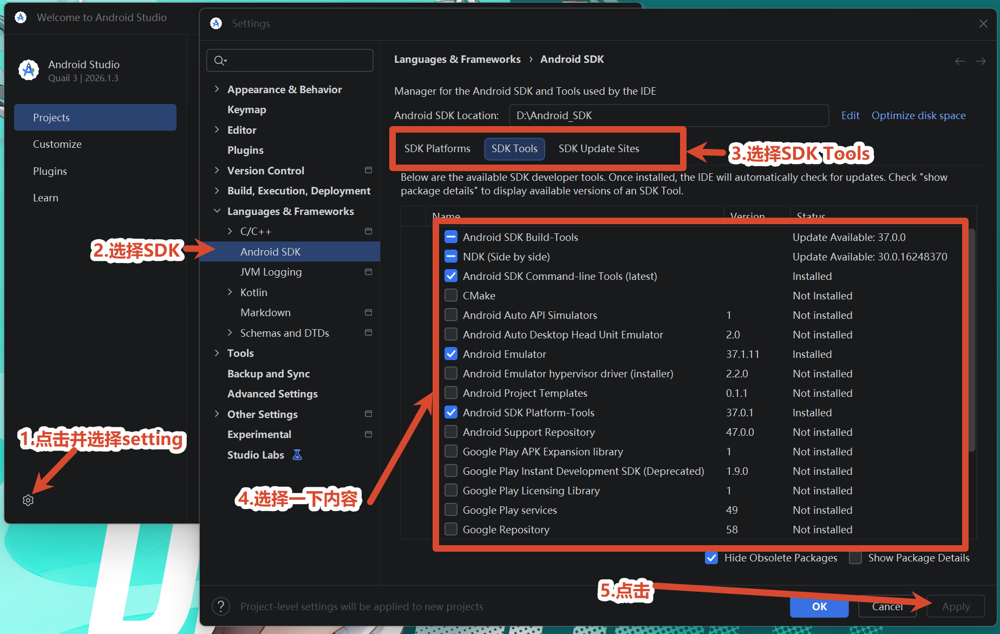
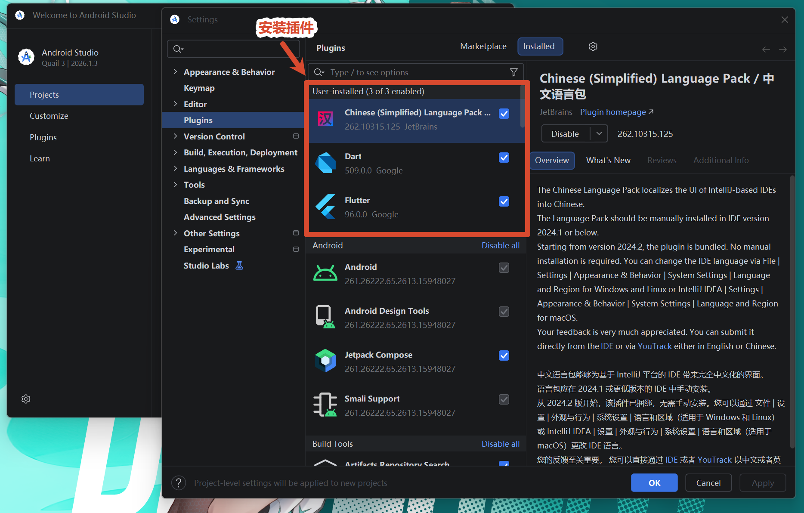
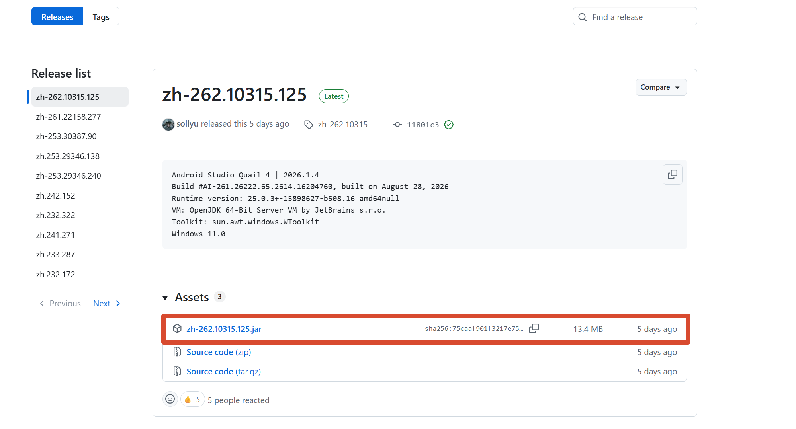
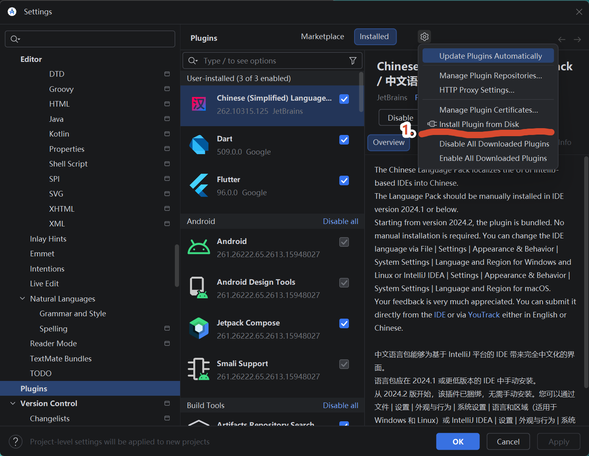
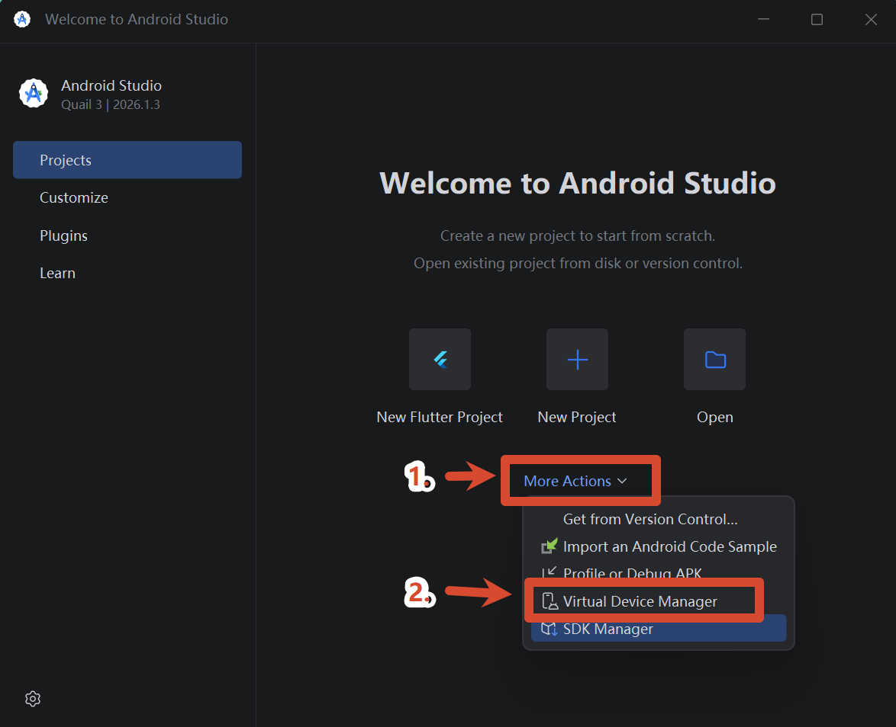
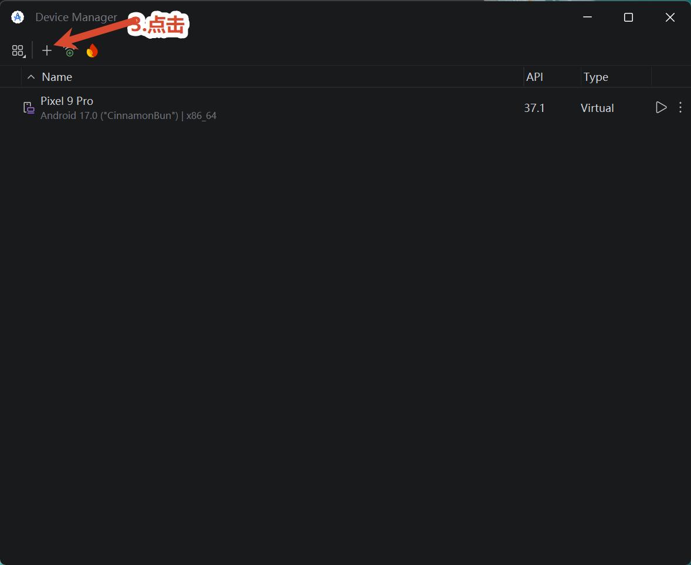
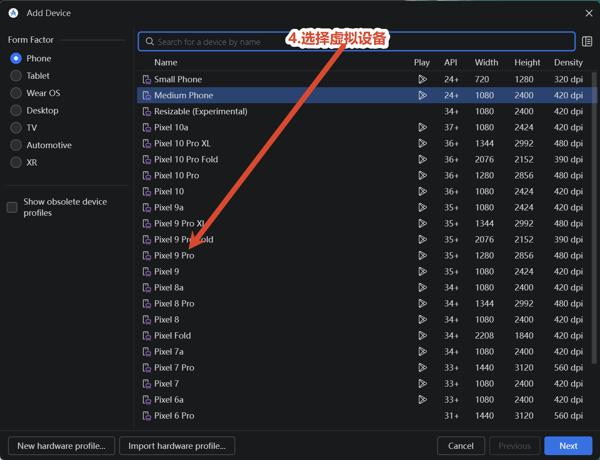
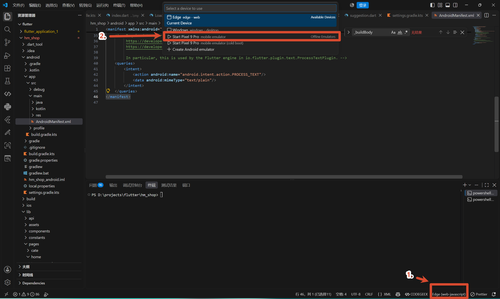

| AGP 版本 | Gradle 版本 | 最低 JDK 要求  |
| ------ | --------- | ---------- |
| 8.x    | 8.x       | **JDK 17** |
| 7.x    | 7.x       | JDK 11     |
| 4.x    | 6.x       | JDK 8/11   |
注：目前 Flutter 3.16+ 的新项目默认使用 AGP 8.x
## JDK
下载地址：[Java Archive Downloads - Java SE 17.0.12 and earlier](https://www.oracle.com/java/technologies/javase/jdk17-archive-downloads.html)
```dash
javac -verson
```
## Android Studio
下载地址：[安装 Android Studio  |  Android Developers](https://developer.android.google.cn/studio/install?hl=zh-cn)
### 1. 设置系统环境变量
```
// 设置虚拟设备的安装路径
ANDROID_AVD_HOME=D:\Android\.android\avd
// 设置Gradle 的用户主目录
GRADLE_USER_HOME=D:\Android\.gradle\
// 设置Dart和Flutter用来存放第三方依赖包缓存路径
PUB_CACHE=D:\Android\pub_cache
```
### 2. 安装Android SDK

### 3. 安装插件

中文插件地址：[Releases · sollyu/AndroidStudioChineseLanguagePack](https://github.com/sollyu/AndroidStudioChineseLanguagePack/releases)
添加方式


### 4. 安装模拟器




## flutter相关指令

| 命令               | 作用                                                       | 影响范围              |
| ---------------- | -------------------------------------------------------- | ----------------- |
| flutter clean    | 删除 `build/`和 `.dart_tool/`等构建产物,依赖项也会被删除                 | 安全，只清理缓存          |
| flutter pub get  | 根据 `pubspec.yaml` 下载依赖，生成 `package_config.json`          | 安全，只更新依赖          |
| flutter create . | 在当前目录重新生成 Flutter 项目结构，包括 `android/`、`ios/`、`web/` 等平台目录 | **有风险，可能覆盖自定义配置** |
## 运行flutter项目到安卓端
### 1. flutter 相关代码补全
使用指令生成各平台目录文件
```
flutter create .
```
### 2. 设置gradle和maven仓库
- 打开android/gradle/wrapper/gradle-wrapper.properties设置distributionUrl为国内镜像地址
```
distributionUrl=https\://mirrors.cloud.tencent.com/gradle/gradle-8.14-all.zip
```
- 修改gradle的maven仓库镜像地址(android/settings.gradle.kts)
```
repositories{
	maven { url = uri("https://maven.aliyun.con/repository/google") }
	maven { url = uri("https://maven.aliyun.com/repository/releases"))
	maven { url = uri("https://maven.aliyun.com/repository/central") }
	maven { url = uri("https://maven.aliyun.con/repository/public") }
	maven { url = uri("https://maven.aliyun.com/repository/gradle-plugin")
	maven { url = uri("https://maven.aliyun.con/repository/apache-snapshots") }
	maven { url = uri("https://maven.aliyun.com/nexus/content/groups/public/")}
	maven { url = uri("https://jitpack.io") }
	maven { url = uri("https://maven.aliyun.com/repository/google") }
	maven { url = uri("https://maven.aliyun.com/repository/releases") }
	maven { url = uri("https://maven.aliyun.com/repository/central") }
	maven { url = uri("https://maven.aliyun.com/repository/public") }
	maven { url = uri("https://maven.aliyun.com/repository/gradle-plugin") }
	maven { url = uri("https://maven.aliyun.com/repository/apache-snapshots") }
	maven { url = uri("https://maven.aliyun.com/nexus/content/groups/public/") }
	maven { url = uri("https://jitpack.io") }
	google()
	mavenCentral()
	gradlePluginPortal()
}
```
### 3. 设置网络权限
- 给安卓侧添加网络权限(android/app/src/main/AndroidManifest.xml)
```
<manifest xmlns:android="http://schemas.android.com/apk/res/android">
	// 添加内容
	<uses-permission android:name="android.permission.INTERNET" />
	......
</manifest>
```
### 选择虚拟设备

### 运行代码
在入口文件中点击Run
### 项目打包
```
flutter build apk --debug #生成调试版 APK (未签名，用于测试)
flutter build apk --release # 生成发布版 APK (需要签名配置)
```
## 参考教程
[教程 - 【2026最新】Android Studio下载+安装+汉化零门槛上手（附安装包） - 个人文章 - SegmentFault 思否](https://segmentfault.com/a/1190000047986996)
## 项目依赖项
```
// 轮播图
carousel_slider: ^5.1.2
// 请求
dio: ^5.11.1
// 数据持久化(保存本地)
get: ^4.7.3
// 数据共享(store)
shared_preferences: ^2.5.5
```
## flutter插件
[Flutter Ducafecat - 开发中常用优秀 Dart Flutter 插件包列表](https://flutter.ducafecat.com/)
[Flutter 主流常用第三方库、插件收集一、Flutter 学习资料 Flutter Flutter官网 Flutte - 掘金](https://juejin.cn/post/7478558847411896360)
[Flutter常用插件汇总尽可能收集好用的Flutter插件以便更效率的开发， 如果有好的插件或者建议，请Issue 或 - 掘金](https://juejin.cn/post/6844904183850631175)
[官方插件](https://github.com/flutter/plugins/tree/master/packages)