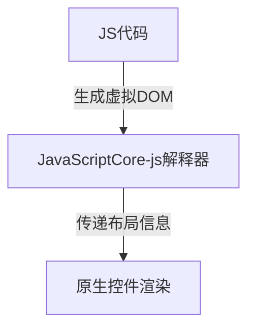

# 原生开发与跨平台技术
## 1. 原生开发
基于某一个移动平台(ios、andriod、harmonyos)的特定开发语言进行应用开发。
### 1.1 原生应用
指某一个移动平台（比如iOS、安卓、harmonyos）所特有的应用，使用相应平台支持的开发工具和语言，并直接调用系统提供的SDK API。主要有以下优势:
- **可访问平台全部功能**（GPS、摄像头）；
- 速度快、性能高、可以实现复杂动画及绘制，整体用户体验好；
主要缺点：
- **平台特定，开发成本高**；不同平台必须维护不同代码，人力成本随之变大；
- **内容固定，动态化弱**，大多数情况下，有新功能更新时只能发版；
## 2. 跨平台技术简介
**为解决动态内容需求过大而应用的审核周期过长以及多平台开发成本过高的问题**，出现多种跨平台框架，主要分三类：
- H5 + 原生（Cordova、Ionic、微信小程序）
- JavaScript 开发 + 原生渲染 （React Native、Weex）
- 自绘UI + 原生 (Qt for mobile、Flutter)
### 2.1 Hybrid技术简介
#### 2.1.1 H5 + 原生
> 这类框架主要原理就是**将 App 中需要动态变动的内容通过HTML5（简称 H5）来实现**，通过原生的网页加载控件**WebView** （Android）或 WKWebView（iOS）来加载。这种 H5 + 原生 的开发模式为**混合开发** ，采用混合模式开发的App我们称之为**混合应用**或 **HTMLybrid App** ，如果一个应用的大多数功能都是 H5 实现的话，我们称其为 **Web App** 。
#### 2.1.2 混合开发技术点
> 原生开发可以访问平台所有功能，而混合开发中，**H5代码是运行在 WebView 中，而 WebView 实质上就是一个浏览器内核**，其 JavaScript 依然运行在一个权限受限的沙箱中，所以对于大多数系统能力都没有访问权限，如**无法访问文件系统、不能使用蓝牙**等。所以，对于 H5 不能实现的功能，就需要原生去做了。

> **混合框架一般都会在原生代码中预先实现一些访问系统能力的 API ， 然后暴露给 WebView 以供 JavaScript 调用**。这样一来，WebView 中 JavaScript 与原生 API 之间就需要一个通信的桥梁，主要负责 JavaScript 与原生之间传递调用消息，而**消息的传递必须遵守一个标准的协议**，它规定了消息的格式与含义，我们把依赖于 WebView 的用于在 JavaScript 与原生之间通信并实现了某种消息传输协议的工具称之为 **WebView JavaScript Bridge** , 简称 **JsBridge**，它也是混合开发框架的核心。

#### 2.1.3 总结
混合应用优点在于动态内容可以用 H5开发，而H5是Web 技术栈，Web技术栈生态开放且社区资源丰富，整体开发效率高。缺点是性能体验不佳，对于复杂用户界面或动画，WebView 有时会不堪重任。
### 2.2 React Native、Weex
#### 2.2.1 React Native
React Native （简称 RN）是一个开源的跨平台移动应用开发框架，RN 使用JSX 语言（扩展后的 JavaScript，主要是可以在 JavaScript 中写 HTML标签）和 CSS 来开发移动应用。

#### 2.2.2 Weex
> Weex 是阿里巴巴于 2016 年发布的跨平台移动端开发框架，思想及原理和 React Native 类似，底层都是通过原生渲染的，不同是应用层开发语法 （即 DSL，Domain Specific Language）：Weex 支持 Vue 语法和 Rax 语法，Rax 的 DSL(Domain Specific Language) 语法是基于 React JSX 语法而创造，而 RN 的 DSL 是基于 React 的，不支持 Vue。
#### 2.2.3 总结
JavaScript 开发 + 原生渲染 的方式主要优点如下：

1. 采用 Web 开发技术栈，社区庞大、上手快、开发成本相对较低。
2. 原生渲染，性能相比 H5 提高很多。
3. 动态化较好，支持热更新。

不足：

1. **渲染时需要 JavaScript 和原生之间通信，在有些场景如拖动可能会因为通信频繁导致卡顿**。
2. JavaScript 为脚本语言，执行时需要解释执行 （这种执行方式通常称为 JIT，即 Just In Time，指在执行时实时生成机器码），执行效率和编译类语言（编译类语言的执行方式为 AOT ，即 Ahead Of Time，指在代码执行前已经将源码进行了预处理，这种预处理通常情况下是将源码编译为机器码或某种中间码）仍有差距。
3. **由于渲染依赖原生控件，不同平台的控件需要单独维护，并且当系统更新时，社区控件可能会滞后；除此之外，其控件系统也会受到原生UI系统限制**，例如，在 Android 中，手势冲突消歧规则是固定的，这在使用不同人写的控件嵌套时，手势冲突问题将会变得非常棘手。这就会导致，如果需要自定义原生渲染组件时，开发和维护成本过高。
### 2.3 Qt Mobile、Flutter
#### 2.3.1 自绘UI + 原生
通过在不同平台实现一个统一接口的渲染引擎来绘制UI，而不依赖系统原生控件，所以可以做到不同平台UI的一致性。**注意，自绘引擎解决的是 UI 的跨平台问题，如果涉及其他系统能力调用，依然要涉及原生开发**。
优点如下：
1. 性能高；由于**自绘引擎是直接调用系统API来绘制UI，所以性能和原生控件接近**。
    
2. 灵活、组件库易维护、UI外观保真度和一致性高；由于UI渲染**不依赖原生控件，也就不需要根据不同平台的控件单独维护一套组件库，所以代码容易维护**。由于组件库是同一套代码、同一个渲染引擎，所以在不同平台，组件显示外观可以做到高保真和高一致性；另外，由于不依赖原生控件，也就不会受原生布局系统的限制，这样布局系统会非常灵活。

不足：

1. 动态性不足；为了保证UI绘制性能，自绘UI系统一般都会采用 AOT 模式编译其发布包，所以**应用发布后，不能像 Hybrid 和 RN 那些使用 JavaScript（JIT）作为开发语言的框架那样动态下发代码**。
2. 应用开发效率低：Qt 使用 C++ 作为其开发语言，而编程效率是直接会影响 App 开发效率的，C++ 作为一门静态语言，在 UI 开发方面灵活性不及 JavaScript 这样的动态语言，**另外，C++需要开发者手动去管理内存分配，没有 JavaScript 及Java中垃圾回收（GC）的机制**。
#### 2.3.2 Qt Mobile
> Qt 是一个1991年由 Qt Company 开发的跨平台 C++ 图形用户界面应用程序开发框架。2008年，Qt Company 科技被诺基亚公司收购，Qt 也因此成为诺基亚旗下的编程语言工具。2012年，Qt 被 Digia 收购。2014年4月，跨平台集成开发环境 Qt Creator 3.1.0 正式发布，实现了对于 iOS 的完全支持，新增 WinRT、Beautifier 等插件，废弃了无 Python 接口的 GDB 调试支持，集成了基于 Clang 的 C/C++ 代码模块，并对 Android 支持做出了调整，至此实现了全面支持 iOS、Android、WP，它提供给应用程序开发者构建图形用户界面所需的所有功能。

#### 2.3.3 Flutter
Flutter 是 Google 发布的一个用于创建跨平台、高性能移动应用的框架。Flutter 和 Qt mobile 一样，都没有使用原生控件，相反**都实现了一个自绘引擎，使用自身的布局、绘制系统**。
### 总结
|技术类型|UI渲染方式|性能|开发效率|动态化|框架代表|
|---|---|---|---|---|---|
|H5 + 原生|WebView渲染|一般|高|支持|Cordova、Ionic|
|JavaScript + 原生渲染|原生控件渲染|好|中|支持|RN、Weex|
|自绘UI + 原生|调用系统API渲染|好|Flutter高, Qt低|默认不支持|Qt、Flutter|
